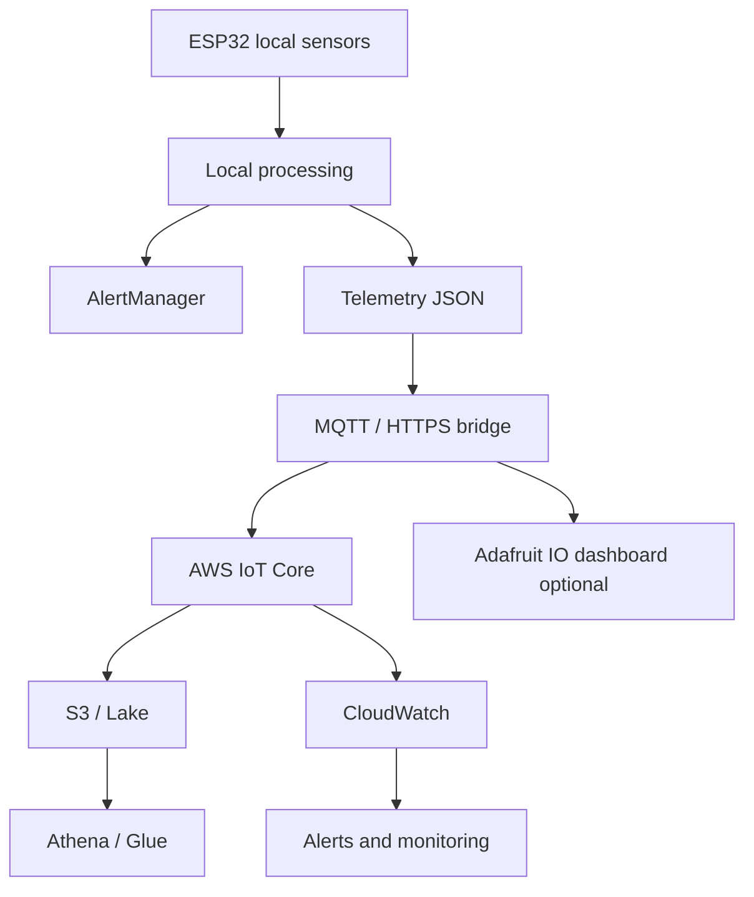

# Arquitectura objetivo

## Objetivo

Diseñar una arquitectura coherente con el alcance real del repositorio: un prototipo local de ESP32 con detección de obstáculos, navegación y alarmas. La arquitectura objetivo debe mantener el procesamiento local como base y permitir expandir, cuando exista necesidad, la telemetría, almacenamiento y visualización a nivel cloud.

## Alternativa A: AWS

### Descripción

Se usaría un modelo basado en dispositivos que publican mensajes seguros a AWS IoT Core. Luego, reglas de enrutamiento canalizarían los eventos hacia S3, Lambda, CloudWatch y eventualmente Athena.

### Beneficios

- Escala para cientos o miles de dispositivos.
- Almacenamiento histórico robusto en S3.
- Herramientas analíticas como Athena, Glue y CloudWatch.
- Mejor para observabilidad, trazabilidad y seguridad en entornos reales.

### Costos y dependencias

- Requiere IAM, certificados, políticas, MQTT y posiblemente Lambda.
- Se requieren costos operativos y diseño de seguridad.
- Tiene mayor complejidad que el prototipo actual.

### Valor para este repositorio

Es la opción más apropiada si el proyecto escala más allá del prototipo y requiere analítica o historial longitudinal. Sin embargo, no es apropiado asumir que esta capa ya existe o está configurada.

## Alternativa B: Adafruit IO

### Descripción

Adafruit IO ofrece un camino más simple para dashboards y feeds de tiempo real, especialmente para prototipos y pruebas rápidas.

### Beneficios

- Publicación rápida de datos con less operational overhead.
- Dashboards o feeds adecuados para demostración.
- Facilita validación de sensores en entornos de laboratorio.

### Limitaciones

- No reemplaza un almacenamiento histórico robusto ni capacidad analítica avanzada.
- Requiere gestión de credenciales y, si se busca trazabilidad profunda, una estrategia complementaria.
- No se debe considerar como un sustituto completo de un sistema de datos a escala empresarial.

### Valor para este repositorio

Es una buena opción para prototipado o demostración visual, pero la evidencia del repositorio no muestra integración actual de Adafruit IO ni configuración de feeds.

## Alternativa C: híbrida AWS + Adafruit IO

### Descripción

Se usa Adafruit IO para visualización rápida y AWS para almacenamiento y trazabilidad.

### Beneficios

- Combina rapidez de prototipado con escalabilidad de nube.
- Permite una capa visual simple y otra capa analítica robusta.
- Reducción del riesgo al mantener la lógica local en el dispositivo.

### Riesgos

- Duplicidad de mensajes si se publica en ambos servicios sin control.
- Costos adicionales y mayor complejidad operativa.
- Dependencia de dos plataformas con políticas y límites distintos.

## Recomendación principal

Se recomienda una arquitectura híbrida planificada, pero con enfoque incremental:

1. Mantener la lógica local en el ESP32 como primera línea de operación.
2. Definir un formato mínimo de telemetría JSON con versionado.
3. Añadir un canal de publicación seguro (MQTT/HTTPS) cuando exista hardware y credenciales reales.
4. Usar AWS IoT Core + S3 + Athena + CloudWatch como capa de almacenamiento y observabilidad.
5. Usar Adafruit IO solo como front-end de demostración o pruebas rápidas si se requiere visualización inmediata.

## Diagrama recomendado

## Decisión

La arquitectura real del repositorio vigente es local y no cloud. Por tanto, la recomendación debe construirse como una evolución controlada:

- Implementada y verificada: sistema local, sensores, navegación, alarma.
- Implementada parcialmente: preparación para telemetría estructurada.
- Pendiente: integración de servicios cloud, almacenamiento persistente, dashboards, alertas centralizadas y métricas operativas.

La decisión no debe forzar un servicio cloud sin evidencias de producción ni credenciales reales. En cambio, debe dejar una ruta de evolución clara, segura y medible.
