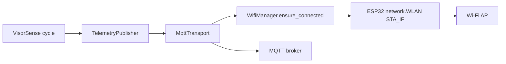

# Despliegue y configuración

## Requisitos actuales

- ESP32 compatible con MicroPython
- Wokwi o hardware real
- Cables para HC-SR04, buzzer, LED, sensor IR y GPS
- Python 3 para validar sintaxis del firmware

## Diseño actual de configuración

La configuración principal está en `src/config.py` y define:

- pines GPIO
- thresholds de distancia
- tiempo del loop principal
- modo de simulación del GPS
- coordenadas de destino

## Variables y ajustes clave

| Configuración | Archivo | Propósito |
| --- | --- | --- |
| `GPS_RX_PIN`, `GPS_TX_PIN` | `src/config.py` | serial GPS |
| `ULTRASONIC_TRIGGER_PIN`, `ULTRASONIC_ECHO_PIN` | `src/config.py` | sensor ultrasónico |
| `INFRARED_PIN` | `src/config.py` | sensor IR |
| `BUZZER_PIN`, `LED_PIN` | `src/config.py` | alarmas locales |
| `NEAR_DISTANCE_CM`, `IMMEDIATE_DISTANCE_CM` | `src/config.py` | niveles de riesgo |
| `LOOP_DELAY_MS` | `src/config.py` | frecuencia del ciclo |
| `SIMULATION_MODE` | `src/config.py` | alternativa local para Wokwi |
| `DEVICE_ID` | `src/config.py` | identidad estable del dispositivo |
| `TELEMETRY_ENABLED` | `src/config.py` | activa el transporte simulado local |
| `MQTT_ENABLED` | `src/config.py` | selecciona MQTT en lugar del transporte simulado |
| `MQTT_BROKER` | `src/config.py` | hostname o IP del broker |
| `MQTT_PORT` | `src/config.py` | puerto MQTT/TLS |
| `MQTT_TOPIC` | `src/config.py` | topic de telemetría |
| `MQTT_CLIENT_ID` | `src/config.py` | identificador MQTT |
| `MQTT_QOS` | `src/config.py` | QoS 0, 1 o 2 |
| `MQTT_KEEPALIVE` | `src/config.py` | keepalive MQTT en segundos |
| `MQTT_TLS` | `src/config.py` | habilita TLS; debe permanecer activo en brokers seguros |
| `MQTT_USERNAME`, `MQTT_PASSWORD` | configuración local | autenticación opcional, nunca se registra |
| `MQTT_SSL_PARAMS` | configuración local | parámetros TLS específicos del cliente |
| `WIFI_ENABLED` | `src/config.py` | permite usar Wi-Fi para MQTT |
| `WIFI_SSID` | configuración local | SSID, nunca se registra |
| `WIFI_PASSWORD` | configuración local | contraseña, nunca se versiona ni registra |
| `WIFI_CONNECT_TIMEOUT_MS` | `src/config.py` | timeout lógico de asociación |
| `WIFI_RECONNECT_INITIAL_MS` | `src/config.py` | backoff inicial Wi-Fi |
| `WIFI_RECONNECT_MAX_MS` | `src/config.py` | backoff máximo Wi-Fi |

## Instrucciones de despliegue local

1. Abrir un proyecto MicroPython para ESP32 en Wokwi o cargar MicroPython en
   un ESP32 físico.
2. Sustituir `diagram.json` por la versión del proyecto.
3. Cargar los archivos de `src/` en la raíz del proyecto Wokwi.
4. Verificar que el entorno sea MicroPython ESP32.
5. Ejecutar la simulación.

Para hardware físico con MQTT:

1. Copiar `wifi_manager.py`, `transport.py`, `telemetry.py`, `device.py`,
   `main.py`, los módulos de sensores y configuración al ESP32.
2. Instalar/copiar una implementación compatible de `umqtt.simple` en el
   sistema de archivos del ESP32.
3. Configurar localmente `WIFI_ENABLED = True`, `WIFI_SSID`,
   `WIFI_PASSWORD`, `MQTT_ENABLED = True` y `MQTT_BROKER`.
4. Usar `MQTT_PORT = 1883` y `MQTT_TLS = False` únicamente para Mosquitto
   local en una red aislada. Para producción, usar TLS, CA/certificados y
   autenticación del proveedor.
5. Ejecutar `main.py` y observar mensajes `Wi-Fi INFO`, `Wi-Fi ERROR` y
   `MQTT ERROR`. Nunca se imprime el SSID junto con la contraseña ni ningún
   secreto.

## Adaptador MQTT

El adaptador está en `src/transport.py` y utiliza la API compatible con
`umqtt.simple` de MicroPython. No se incluye ni se fija una versión de la
biblioteca en este repositorio: debe copiarse una versión compatible al
dispositivo antes de activar `MQTT_ENABLED`. En el host se prueban contratos
con un cliente MQTT falso, no una conexión real.

La configuración usa valores ficticios o vacíos por defecto y MQTT está
desactivado. Para un broker TLS real se requieren:

- `MQTT_BROKER`, `MQTT_PORT`, `MQTT_TOPIC` y `MQTT_CLIENT_ID`
- credenciales o certificados mediante `MqttConfig`, fuera del repositorio
- `ssl=True` y `ssl_params` con la CA/certificado requerido por el broker
- conectividad Wi-Fi implementada y probada por separado

## Conectividad Wi-Fi

`src/wifi_manager.py` utiliza la interfaz `network.WLAN(network.STA_IF)` de
MicroPython. `WifiManager.ensure_connected()` no duerme: cada llamada avanza
el estado de conexión, detecta asociación, timeout o desconexión y aplica un
backoff acotado. Esto permite que el ciclo de sensores continúe aunque la red
no esté disponible.

El flujo integrado es:



El firmware no se activa en modo MQTT si `WIFI_ENABLED` es falso, el SSID está
vacío, falta la contraseña o el broker está vacío. En ese caso registra un
mensaje explícito y conserva `SimulatedTransport`.

Para mantener credenciales fuera de Git, copiar
`src/config_local.example.py` como `src/config_local.py`, editar únicamente la
copia local y transferir ambos `config.py` y `config_local.py` al ESP32. El
archivo `config_local.py` está ignorado por Git y es cargado automáticamente si
existe; si no existe, se usan los valores seguros por defecto y MQTT permanece
desactivado. No se debe transferir el archivo de ejemplo esperando que habilite
conectividad: primero hay que reemplazar sus marcadores localmente.

Para un broker local sin TLS, únicamente en una red de pruebas aislada:

```python
MQTT_ENABLED = True
MQTT_BROKER = "192.0.2.10"  # ejemplo reservado; reemplazar localmente
MQTT_PORT = 1883
MQTT_TOPIC = "visorsense/telemetry"
MQTT_TLS = False
```

No se debe copiar este ejemplo como configuración de producción ni desactivar
la validación TLS para resolver errores de conexión.

`MqttTransport.send()` intenta como máximo una conexión y una publicación por
ciclo. Los fallos programan reintentos con backoff progresivo acotado, sin
`sleep` prolongado en el ciclo de sensores. Una publicación sin excepción
representa aceptación por el cliente MQTT; con `umqtt.simple` no equivale a una
confirmación independiente de persistencia del broker.

## Prueba con Mosquitto local

Estas instrucciones prueban el broker desde un equipo de desarrollo. No
constituyen una prueba AWS ni una prueba end-to-end del ESP32:

1. Instalar Mosquitto y sus herramientas de cliente en el equipo de
   desarrollo.
2. Iniciar un broker de laboratorio:

   ```text
   mosquitto -v -p 1883
   ```

3. En otra terminal, suscribirse al topic:

   ```text
   mosquitto_sub -h 127.0.0.1 -p 1883 -t visorsense/telemetry -v
   ```

4. Para un ESP32 físico, usar la dirección LAN del equipo que ejecuta
   Mosquitto, no `127.0.0.1`; configurar `MQTT_PORT = 1883` y
   `MQTT_TLS = False` sólo dentro de esta red de laboratorio.
5. Copiar una implementación compatible de `umqtt.simple` al ESP32 y activar
   `MQTT_ENABLED` junto con Wi-Fi. 
6. Confirmar que el suscriptor recibe JSON y que la consola del firmware no
   reporta `MQTT ERROR`.

Para verificar sólo el adaptador sin hardware ni dependencias externas:

```text
python -m unittest discover -s tests -v
```

Las pruebas usan un cliente MQTT controlado y cubren publicación, fallo,
backoff de reconexión, QoS/topic y validación de configuración.

## Infraestructura AWS declarativa

La infraestructura futura está separada en
`infra/aws/terraform/`. Puede validarse sin despliegue con:

```text
terraform fmt -check -recursive
terraform init -backend=false -input=false
terraform validate
```

No ejecutar `terraform apply` o `terraform destroy` desde esta etapa. La
infraestructura, los costos y el procedimiento de certificados están
documentados en `infra/aws/terraform/README.md` y
`docs/costos_aws_free_tier_2026.md`.

## Limitaciones del despliegue actual

- No existen archivos `.env`, secretos ni credenciales.
- No hay infraestructura de AWS ni Adafruit IO configurada.
- No se ejecutan scripts de despliegue ni pipelines de CI.
- No existe un entorno de pruebas de integración cloud.
- No se ha ejecutado una prueba física Wi-Fi/MQTT en este entorno.

## Transporte y diagnóstico

`src/transport.py` define `TelemetryTransport.send(payload)`, que debe devolver
`True` sólo con confirmación suficiente del destino. `SimulatedTransport` es el
adaptador actual para Wokwi y pruebas; conserva como máximo diez payloads.

Para diagnosticar un fallo, revisar primero:

1. resolución y accesibilidad del broker desde la red del ESP32;
2. correspondencia entre puerto y `MQTT_TLS`;
3. certificados/credenciales sin imprimir sus valores;
4. `connect_attempts`, `publish_attempts` y `publish_failures`;
5. mensajes `MQTT ERROR` de la consola.
6. mensajes `Wi-Fi ERROR` y los contadores de intentos/fallos del
   `WifiManager`.

El `connect_timeout_ms` está documentado en `MqttConfig`, pero `umqtt.simple`
no expone un timeout de conexión uniforme en su constructor; su aplicación
efectiva depende de la biblioteca/socket concreta y debe validarse en el
hardware elegido.

## Recomendación de escalado

Al crecer el sistema, la configuración debe externalizarse a variables de entorno, separación de secretos y despliegue reproducible. Para el estado actual, la configuración local del firmware es apropiada y suficiente.
