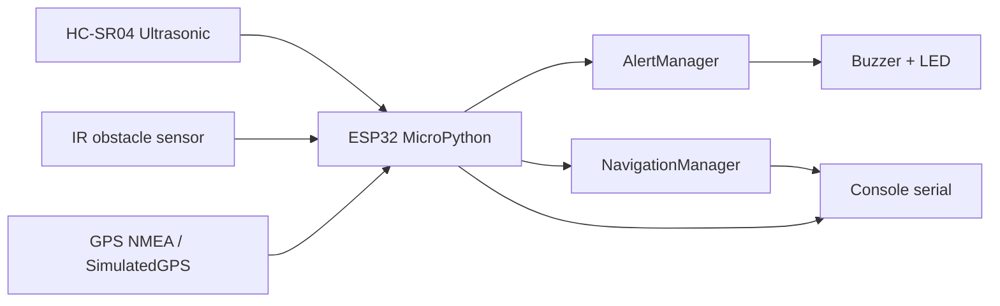

# Diagnóstico del sistema actual

## Resumen ejecutivo

El repositorio implementa un prototipo local de monitoreo y navegación para un dispositivo ESP32 basado en MicroPython. La evidencia del código indica que el sistema funciona como una aplicación embebida autónoma, orientada a la detección de obstáculos y guía de navegación, sin integración con servicios cloud ni persistencia de datos históricos.

La arquitectura actual es de tipo local-first: sensores, lógica de decisión y alertas se ejecutan en el mismo dispositivo ESP32. El flujo principal del sistema se observa en `src/main.py`, `src/device.py`, `src/sensors.py`, `src/gps.py`, `src/navigation.py` y `src/alerts.py`.

### Clasificación general

- Confirmado: el sistema es un firmware MicroPython para ESP32 y se ejecuta en Wokwi.
- Confirmado: usa HC-SR04, sensor IR, buzzer, LED y GPS NMEA o simulado.
- Confirmado: no hay integración de AWS ni Adafruit IO en el repositorio.
- Probable: la intención original del proyecto era incluir más funciones de monitoreo y batería, pero esas piezas no están implementadas en la rama actual.
- Pendiente de verificación: conectividad Wi‑Fi, MQTT, API REST y almacenamiento en la nube.

## Inventario de componentes

| Componente | Evidencia | Estado |
| --- | --- | --- |
| ESP32 DevKit C v4 | `src/diagram.json` | Confirmado |
| Sensor ultrasónico HC-SR04 | `src/sensors.py`, `src/diagram.json` | Confirmado |
| Sensor IR digital | `src/sensors.py`, `src/config.py` | Confirmado |
| Buzzer + LED | `src/alerts.py`, `src/diagram.json` | Confirmado |
| GPS NMEA / GPS simulado | `src/gps.py`, `src/main.py`, `src/config.py` | Confirmado |
| Navegación local | `src/navigation.py` | Confirmado |
| Console serial de estado | `src/device.py` | Confirmado |
| AWS IoT / S3 / Athena | No existe en repo | Pendiente |
| Adafruit IO | No existe en repo | Pendiente |
| Bibliotecas externas de cloud | No existen | Confirmado |

## Arquitectura actual

### Flujo real de datos

1. `src/main.py` crea la instancia del dispositivo y configura sensores, alertas y navegación.
2. `src/device.py` ejecuta un ciclo continuo llamado `run_cycle()`.
3. `UltrasonicSensor.distance_cm()` lee la distancia con `time_pulse_us()`.
4. `InfraredSensor.obstacle_detected()` lee el estado digital del sensor IR.
5. `AlertManager.update()` decide si activar buzzer y LED según el riesgo.
6. `gps.read_position()` devuelve posición real o simulada.
7. `NavigationManager.instruction()` calcula una dirección simple hacia un destino.
8. El sistema imprime el estado en la consola serial.

### Diagrama de arquitectura



## Evidencia del código

### Sensores y variables físicas

- `UltrasonicSensor.distance_cm()` en `src/sensors.py` calcula la distancia en centímetros a partir del tiempo de vuelo del pulso ultrasónico.
- `InfraredSensor.obstacle_detected()` en `src/sensors.py` valida el estado digital del sensor IR.
- `NavigationManager` en `src/navigation.py` compara latitud/longitud con un destino fijo para decidir si se mueve norte, sur, este u oeste.
- `AlertManager` en `src/alerts.py` define los umbrales operativos:
  - `<= 20 cm`: riesgo inmediato
  - `<= 50 cm`: riesgo cercano
  - `<= 150 cm`: riesgo distante
  - por encima de 150 cm: sin alerta

### Identificación del dispositivo

No existe un identificador persistente del dispositivo ni un registro de estado de conexión. El proyecto no genera ni publica `device_id` ni `boot_id` ni heartbeat. Esto es un hallazgo clave: el firmware imprime un estado local, pero no puede diferenciar un dispositivo conectado de uno que esté enviando datos realmente.

### Formato de mensajes

El sistema no publica mensajes JSON ni mensajes MQTT, y tampoco define un esquema versionado. El output visible es texto plano por consola serial:

```python
print(
    "Distance: {} | GPS: {} | IR: {} | Risk: {} | Navigation: {}".format(
        distance_text,
        gps_text,
        "OBSTACLE" if infrared_obstacle else "CLEAR",
        risk,
        instruction,
    )
)
```

Esto demuestra que no existe un protocolo de transmisión ni un modelo de datos con schema versionado.

### Frecuencia de adquisición

La frecuencia principal está definida por `LOOP_DELAY_MS` en `src/config.py`:

```python
LOOP_DELAY_MS = 100
```

Eso indica un ciclo de aproximadamente 100 ms de espera entre iteraciones, aunque el GPS simulado sólo actualiza su posición cada segundo.

### Conectividad y autenticación

No existen:

- Wi‑Fi management
- MQTT client
- TLS configuration
- secrets management
- IAM policies
- certificados
- cloud auth credentials

La afirmación de que el sistema "usa AWS o Adafruit IO" no se sostiene con evidencia del código. El actual repositorio no configura ni consume esos servicios.

## Tabla de funcionalidades existentes, incompletas y faltantes

| Funcionalidad | Estado | Evidencia | Observación |
| --- | --- | --- | --- |
| Lectura de ultrasonido | Implementada | `src/sensors.py` | Funciona localmente |
| Detección IR | Implementada | `src/sensors.py` | Funciona localmente |
| Navegación simple | Implementada | `src/navigation.py` | Dirección cardinal simple |
| Alertas acústicas/visuales | Implementada | `src/alerts.py` | Buzzer + LED |
| GPS lectura real NMEA | Implementada | `src/gps.py` | Requiere hardware real |
| GPS simulado | Implementada | `src/gps.py` | Soporta Wokwi |
| Monitoreo de batería | Parcial/pendiente | README menciona batería; no hay `power.py` ni código real | Inconsistencia entre README y código |
| Publicación cloud | Pendiente | No existe | No hay AWS o Adafruit IO |
| Persistencia histórica | Pendiente | No existe | Sin almacenamiento |
| Dashboard y visualización | Pendiente | No existe | Necesita servicio externo |
| Heartbeat y dispositivo online/offline | Pendiente | No existe | Falta identidad y estado |
| Alertas operativas cloud | Pendiente | No existe | Sin CloudWatch/alarma |
| Pruebas automatizadas | Pendiente | Sin framework detectado | No hay suite en repo |

## Dependencias e integraciones

### Dependencias detectadas

- MicroPython para ESP32
- `machine` module (`Pin`, `UART`, `time_pulse_us`)
- `time` module
- Wokwi simulation project file (`src/diagram.json`)

### Integraciones reales

- Ninguna integración con AWS bajo código o configuración.
- Ninguna integración con Adafruit IO bajo código o configuración.
- No se detectan variables de entorno, secretos ni archivos de configuración cloud.

## Riesgos de seguridad

| Riesgo | Nivel | Comentario |
| --- | --- | --- |
| Secrets hardcodeadas | Medio | No hay secretos publicados; aún así, no existe un pipeline de gestión segura |
| Ausencia de TLS/MQTT auth | Medio | El sistema no se conecta a red, pero una futura ampliación debe usar TLS y credenciales protegidas |
| Datos sin validación de entrada | Medio | GPS y sensores no validan rangos físicos en un sistema de producción |
| Dependencia de estado local sin registro | Medio | Fallos, reinicios y desconexiones no se rastrean |
| Log excesivo de diagnóstico | Bajo | En la consola serial puede revelar más información de la necesaria |

## Problemas de confiabilidad y escalabilidad

- La lógica de navegación es sencilla y no maneja latencia ni pérdida de GPS.
- La lectura de GPS real puede fallar si se recibe NMEA incompleto o corrupto.
- No hay reintentos ni buffer local para datos durante pérdida de red.
- No hay manejo de memoria ni almacenamiento persistente para eventos.
- El sistema no diferencia entre “sensor desconectado”, “lectura inválida” y “sin GPS”.
- La arquitectura local no escala a un conjunto de dispositivos distribuidos ni a analítica histórica.

## Limitaciones de almacenamiento y monitoreo

- El almacenamiento actual es solo la salida en consola (`print`).
- No hay archivo local ni base de datos.
- No hay histograma ni series temporales de mediciones.
- No hay métrica de latencia, pérdida de comunicación ni tasa de mensajes.
- No hay alertas operativas más allá del buzzer y LED local.

## Recomendaciones priorizadas

### Prioridad 1: documentar el alcance real y evitar promesas de infraestructura no implementada

- Corregir la documentación que menciona baterías, controller.py, models.py y cloud services que no existen.
- Mantener el alcance del repositorio alineado con la realidad del código.

### Prioridad 2: definir un esquema de estados del dispositivo

- `device_id`, `timestamp`, `status`, `sensor_ok`, `last_seen`, `firmware_version`.
- Añadir heartbeat local para distinguir “vigente” de “sin datos”.

### Prioridad 3: preparar una capa de salida de telemetría

- Añadir serialización JSON con campos mínimos y versionado.
- Segmentar mediciones, estado y eventos.
- Diseñar un mecanismo de exportación o log estructurado.

### Prioridad 4: diseñar la arquitectura objetivo de forma híbrida

- Local processing en el dispositivo.
- Publicación opcional hacia MQTT o HTTP.
- Persistencia en un servicio cloud posterior.
- Dashboards y alertas en capas superiores.

### Prioridad 5: mejorar robustez local

- Validaciones por rango físico.
- Reconocimiento de desconexiones de sensor.
- Registrado de errores sin bloquear el ciclo principal.

## Conclusión

El repositorio actual representa un prototipo funcional de ESP32 con sensores y navegación local, pero no una solución IoT cloud completa. La documentación debe describir el sistema como un entorno de simulación y validación local, y no como un ecosistema desplegado en AWS o Adafruit IO.

La principal oportunidad es evolucionar desde un prototipo local hacia una arquitectura híbrida con telemetría estructurada, calidad de datos y observabilidad, manteniendo siempre el procesamiento local como primer nivel de robustez.
