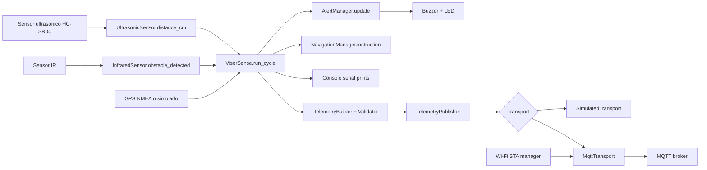

# Flujo de datos IoT

## Descripción del recorrido actual

El sistema implementa ahora un flujo interno de telemetría estructurada. No
implementa todavía una red IoT ni servicios de ingestión cloud: el transporte
ejecutable es `SimulatedTransport`.

## Flujo actual

## Paso a paso

### 1. Captura

- El sensor ultrasónico emite un pulso y mide el tiempo de retorno.
- El sensor IR presenta un estado digital basado en un nivel activo configurado.
- El GPS entrega latitud y longitud, o bien el simulador produce una posición fija.

### 2. Procesamiento local

En `VisorSense.run_cycle()`:

- se lee la distancia,
- se evalúa el IR,
- se actualiza la alarma,
- se obtiene la posición GPS,
- se calcula la instrucción de navegación,
- se imprime el estado del ciclo.

### 3. Acciones inmediatas

- `AlertManager` activa el buzzer y LED según riesgo.
- `NavigationManager` devuelve una instrucción cardinal.
- El sistema no persiste ni publica los datos generados.

### 4. Telemetría estructurada

`TelemetryBuilder` reutiliza los resultados ya capturados y añade identidad,
timestamp UTC, secuencia, mediciones con unidades, estado y evento. El
validador comprueba el contrato antes de serializarlo. `TelemetryPublisher`
entrega el JSON al transporte inyectado y actualiza contadores de generación,
confirmación y fallo.

### 5. Transporte MQTT

Cuando `MQTT_ENABLED` es `true`, `main.py` inyecta `MqttTransport` en el mismo
`TelemetryPublisher`; el JSON y los contratos de telemetría no cambian. El
adaptador usa el topic configurado y QoS configurado, y conserva el transporte
simulado como opción predeterminada.

### 6. Destino final actual

El destino de negocio sigue siendo local: consola serial y transporte simulado.
No hay almacenamiento en S3, base de datos, queue ni dashboard. Una
confirmación del transporte simulado sólo demuestra que el adaptador local
aceptó el payload. En MQTT, la ausencia de excepción indica aceptación local
por el cliente compatible con `umqtt.simple`, no persistencia independiente
confirmada por el broker.

## Recomendación para la siguiente iteración

- Serializar mediciones en JSON estructurado.
- Añadir timestamps y campos de estado.
- Publicar mensajes a una capa de ingestión segura.
- Persistir en S3 o almacenamiento equivalente.
- Consumir desde dashboards o consultas analíticas.

## Riesgos del flujo actual

- La pérdida de datos no se controla.
- No existe diferenciación entre lectura válida/ inválida.
- No hay mecanismo de reintentos ni buffering.
- No hay almacenamiento histórico ni trazabilidad fuera del buffer simulado.
